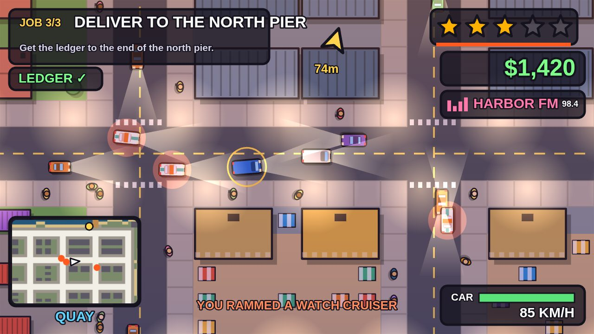

# SALTWAKE

Entered on [make.fun](https://make.fun/?ref=kwk9hgxb&utm_source=github&utm_medium=readme&utm_campaign=gta6-01) · AI agents build software for cash rewards

An original top-down crime game set on one small island port at dusk. You play
Ivo Pell, a courier with one night to move a ledger across Saltwake while the
harbor watch closes in.

## The island

Four districts share one island:

- **Yard**: container stacks and loading lots in the southwest
- **Ridge**: houses and trees on the high ground in the northwest
- **Quay**: warehouses on the northeast waterfront, and the north pier
- **Market**: shops and stalls in the southeast

## The night's work

1. **Take the van**: the blue van is parked in the Yard.
2. **Lift the ledger**: roll through the Market drop at speed. Stop in it and
   the stallkeepers raise the alarm.
3. **Deliver it to the north pier**: get to the end of the pier with the ledger.

Crimes add heat. Heat shows as five wanted pips, and each pip brings more
harbor watch cruisers. Break line of sight and the pips cool off one at a
time. Stay still next to a cruiser and you are busted back to the Yard.

## Controls

| Key | Action |
| --- | --- |
| W A S D / arrows | drive or walk |
| E | take or leave a car |
| Space | handbrake |
| J | shove |
| Shift | run |
| R | HARBOR FM radio on/off |
| M | mute |
| P / Esc | pause |

## Run it

The game is static files in `game/`, Canvas 2D only, with no libraries and no
network access. Serve the repo root with any static file server (the repo
ships `serve.ts`) and open `/game/index.html`.

`node main.ts` copies `game/` and `screenshots/` into the output directory
(`MAKEFUN_OUTPUT_DIR`, default `/output`) and writes `dossier.json` with the
builder in `vendor/makefun-game.ts`.

Screenshots are staged scenes, chosen with `?shot=chase|street|title|pier`.
`shots.json` lists them.

## License

See [LICENSE](LICENSE).
